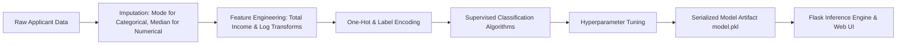

# Loan Default & Eligibility Prediction System

> An end-to-end Machine Learning classification pipeline and Flask web application predicting applicant loan eligibility based on financial, demographic, and credit risk factors.


---

## Table of Contents
- [Overview](#overview)
- [Dataset & Features](#dataset--features)
- [Modeling Pipeline](#modeling-pipeline)
- [Project Structure](#project-structure)
- [Quick Start](#quick-start)
- [License](#license)

---

## Overview

Credit evaluation is a core function for banking institutions. Manual underwriting is time-intensive and susceptible to inconsistent decision-making. 

This project develops an automated risk scoring and loan eligibility engine trained on historical applicant records. The trained model is packaged with a Flask web application allowing loan officers or applicants to input applicant attributes and receive instantaneous eligibility verdicts.

---

## Dataset & Features

The model processes applicant records containing both categorical and numerical features:

| Feature Name | Description | Type |
|---|---|---|
| `Gender` | Male / Female | Binary |
| `Married` | Marital status (Yes / No) | Binary |
| `Education` | Graduate / Under Graduate | Binary |
| `Self_Employed` | Self-employment status (Yes / No) | Binary |
| `ApplicantIncome` | Primary applicant gross income | Continuous |
| `CoapplicantIncome` | Additional co-applicant income | Continuous |
| `LoanAmount` | Loan amount requested (thousands) | Continuous |
| `Loan_Amount_Term` | Repayment term duration (months) | Discrete |
| `Credit_History` | Credit history guidelines met (1: Yes, 0: No) | Binary |
| `Property_Area` | Urban / Semiurban / Rural | Categorical |

---

## Modeling Pipeline



---

## Project Structure

```
loan-default-prediction/
├── app.py                      # Flask web application entrypoint
├── utils.py                    # Preprocessing & model inference wrapper
├── model.pkl                   # Serialized trained scikit-learn classifier
├── requirements.txt            # Python dependencies
├── dataset/
│   ├── train_u6lujuX_CVtuZ9i.csv # Training data
│   └── test_Y3wMUE5_7gLdaTN.csv  # Test evaluation data
├── notebooks/
│   └── loan_prediction_modeling.ipynb # EDA, preprocessing, and model training
├── templates/
│   ├── layout.html             # Base layout template
│   ├── index.html              # Applicant input form
│   └── predict.html            # Approval decision display
├── static/
├── .gitignore
├── LICENSE
└── README.md
```

---

## Quick Start

### 1. Environment Setup

```bash
# Clone the repository
git clone https://github.com/FresherMen/loan-default-prediction.git
cd loan-default-prediction

# Create and activate virtual environment
python3 -m venv venv
source venv/bin/activate  # On Windows: venv\Scripts\activate

# Install dependencies
pip install -r requirements.txt
```

### 2. Launch the Web Application

```bash
python app.py
```

Access the interface in your browser at `http://localhost:5000`.

---

## License

This project is licensed under the MIT License.
